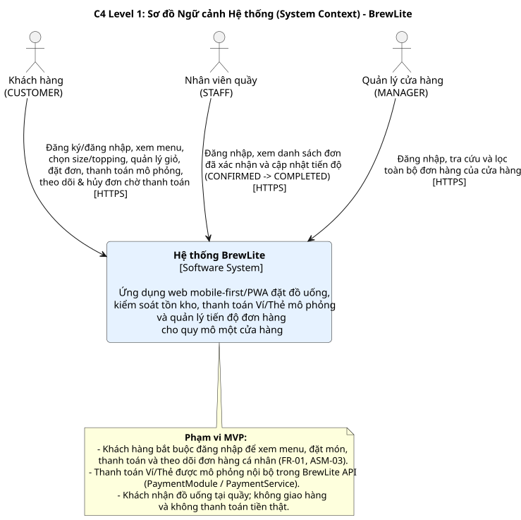
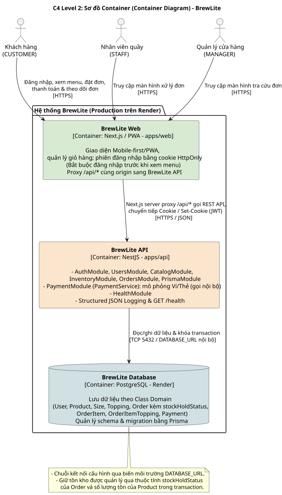

# Tổng quan Kiến trúc Hệ thống BrewLite (C4 Model)

## 1. Sơ đồ Ngữ cảnh (System Context – C4 Level 1)

*Tệp nguồn:* [`c4-context.puml`](c4-context.puml)

**Hệ thống mục tiêu:** **Hệ thống BrewLite** là ứng dụng web ưu tiên thiết bị di động (mobile-first/PWA) phục vụ quy trình xem menu, đặt đồ uống, kiểm soát tồn kho, thanh toán Ví/Thẻ mô phỏng nội bộ và quản lý tiến độ đơn hàng cho quy mô một cửa hàng duy nhất.

**Các tác nhân tương tác với hệ thống:**
* **Khách hàng (`CUSTOMER`):** Phải đăng nhập bằng tài khoản hợp lệ để xem menu, chọn size/topping, quản lý giỏ hàng, đặt đơn, thanh toán Ví/Thẻ mô phỏng, theo dõi lịch sử/trạng thái đơn hàng cá nhân. Khách chỉ có thể yêu cầu hủy đơn của mình khi đơn ở trạng thái `PENDING_PAYMENT` và không có lần thanh toán `PROCESSING` (`FR-01`, `FR-23`).
* **Nhân viên quầy (`STAFF`):** Đăng nhập, xem danh sách đơn đã xác nhận (`CONFIRMED`) và cập nhật trạng thái pha chế theo đúng trình tự.
* **Quản lý cửa hàng (`MANAGER`):** Đăng nhập; tra cứu và lọc toàn bộ đơn hàng của cửa hàng, bao gồm đơn chờ thanh toán và đơn có lần thanh toán thất bại (chức năng `FR-11`, mức ưu tiên `Should`).

**Thanh toán:** Thanh toán Ví/Thẻ được mô phỏng nội bộ bên trong `BrewLite API` thông qua `PaymentModule` (`PaymentService`); không kết nối cổng thanh toán thật và không xử lý tiền thật.

## 2. Sơ đồ Container (Container Architecture – C4 Level 2)

*Tệp nguồn:* [`c4-container.puml`](c4-container.puml)

Ở mức C4 Level 2, hệ thống được phân rã thành **ba container**:

### 2.1. BrewLite Web (`apps/web` – Next.js/PWA)
* **Vai trò:** Cung cấp giao diện mobile-first/PWA cho Khách hàng, Nhân viên quầy và Quản lý.
* **Trách nhiệm:** Quản lý trạng thái giỏ hàng và trạng thái phiên người dùng (không đọc JWT trong JavaScript); hiển thị menu và chi tiết món; kiểm tra dữ liệu đầu vào phía client; hiển thị các trạng thái UI. Trình duyệt gọi `/api/*` cùng origin trên BrewLite Web; Next.js server proxy chuyển tiếp request đến BrewLite API qua HTTPS.
* **Quy tắc truy cập:** Khách hàng bắt buộc phải đăng nhập mới xem được menu, đặt món, thanh toán và truy cập đơn hàng cá nhân. API kiểm tra JWT và quyền ở phía server, không chỉ dựa vào điều hướng trên UI.
* **Phiên xác thực:** JWT nằm trong cookie `HttpOnly; Secure; SameSite=Lax; Path=/`, hiệu lực 30 phút, không dùng refresh token trong MVP và không lưu JWT vào `localStorage`. Next.js proxy chuyển tiếp `Cookie`/`Set-Cookie` giữa Web và API; `POST /api/auth/login`, `GET /api/auth/me`, `POST /api/auth/logout` được ánh xạ đến các đường dẫn `/auth/*` tương ứng ở NestJS.
* **Chi tiết:** [`frontend-architecture.md`](frontend-architecture.md).

### 2.2. BrewLite API (`apps/api` – NestJS)
* **Vai trò:** Xử lý toàn bộ nghiệp vụ lõi (Business Logic), thanh toán mô phỏng và bảo mật.
* **Các module nghiệp vụ:** `AuthModule`, `UsersModule`, `CatalogModule`, `InventoryModule`, `OrdersModule` và `PaymentModule` (`PaymentService`).
* **Trách nhiệm:** Cấp JWT trong `Set-Cookie` khi đăng nhập, đọc và xác thực JWT từ cookie, phân quyền và thu hồi token (`jti`) khi đăng xuất; thực thi Order State Machine (`PENDING_PAYMENT → CONFIRMED → PREPARING → READY → COMPLETED` và nhánh hủy `CANCELLED`); khóa dòng `Order` và bản ghi tồn kho trong database transaction để chốt hoặc giải phóng qua thuộc tính `stockHoldStatus` của `Order`; chống tạo đơn trùng bằng `requestId`.
* **Thanh toán nội bộ:** `PaymentService` nằm trong `PaymentModule`, xử lý `POST /orders/{id}/payments` với khóa `idempotencyKey` để nhận diện yêu cầu trùng.
* **Vận hành:** Ghi log JSON có cấu trúc (lọc secrets), cung cấp `GET /health` kiểm tra PostgreSQL.
* **Chi tiết:** [`backend-data-design.md`](backend-data-design.md), [`backend-operations.md`](backend-operations.md).

### 2.3. BrewLite Database (PostgreSQL trên Render)
* **Vai trò:** Lưu trữ dữ liệu bền vững (Persistent Storage) của hệ thống.
* **Dữ liệu chính:** Lưu dữ liệu theo Class Domain (`User`, `Product`, `Size`, `Topping`, `Order` kèm `stockHoldStatus`, `OrderItem`, `OrderItemTopping`, `Payment`; `Promotion`, `LoyaltyTransaction` thuộc phạm vi mở rộng).
* **Migration & Seed:** Sử dụng **Prisma** (`Prisma Migrate`) để quản lý schema. Seed dữ liệu là tác vụ chạy riêng khi khởi tạo.
* **Kết nối & Bảo mật:** Kết nối qua biến môi trường `DATABASE_URL` nội bộ trên Render; chặn kết nối trực tiếp từ Internet.
* **Chi tiết:** [`backend-data-design.md`](backend-data-design.md).

## 3. Quy ước kiến trúc và dữ liệu dùng chung

1. **Tên 3 container C4:** `BrewLite Web`, `BrewLite API`, `BrewLite Database`.
2. **Module Backend:** `AuthModule`, `UsersModule`, `CatalogModule`, `InventoryModule`, `OrdersModule`, `PaymentModule` (`PaymentService`), `PrismaModule`, `HealthModule`.
3. **Migration & Connection:** Quản lý bằng Prisma; chuỗi kết nối đặt trong `DATABASE_URL`.
4. **Seed dữ liệu:** Chạy chủ động bằng tác vụ riêng.
5. **Luồng web/API:** Browser/PWA → HTTPS đến BrewLite Web (`/api/*`) → Next.js server proxy → HTTPS đến BrewLite API (backend endpoints không có tiền tố proxy `/api`) → PostgreSQL qua kết nối nội bộ. Browser không gọi trực tiếp hostname backend.
6. **Quản lý phiên:** JWT trong HttpOnly Cookie, `Secure; SameSite=Lax; Path=/`, 30 phút; backend kiểm tra quyền, thu hồi JWT khi logout. Cần kiểm thử bảo vệ CSRF cho thao tác thay đổi trạng thái theo thiết kế frontend và deployment.
7. **Truy vết triển khai:** Cấu hình upstream cho proxy chỉ nằm ở môi trường Next.js server, không phải biến `NEXT_PUBLIC_*`. Tài liệu Deployment mô tả luồng này; URL, dịch vụ và mã nguồn triển khai thực tế cần được xác minh trong Task 4–5.

## 4. Lý do chọn kiến trúc, Ưu điểm, Hạn chế và Đánh đổi (Trade-offs)

### 4.1. Lý do lựa chọn kiến trúc C4 kết hợp Modular Monolith
- Phù hợp với quy mô dự án MVP một cửa hàng trong 2 Sprint của nhóm 5 thành viên.
- Mô hình C4 giúp liên kết ngữ cảnh nghiệp vụ, ba container hệ thống và các component chuyên môn.

### 4.2. Ưu điểm và Hạn chế tổng thể
- **Ưu điểm:** Kiến trúc gọn với ba container; sử dụng các database transaction riêng cho việc tạo đơn và giữ tồn kho, ghi nhận lần thanh toán, cập nhật kết quả thanh toán và chốt hoặc giải phóng tồn kho. `requestId` và `idempotencyKey` hỗ trợ chống xử lý trùng theo Sequence Checkout.
- **Hạn chế:** Các module chạy chung trong một tiến trình nên chưa thể mở rộng quy mô độc lập từng phân hệ.

### 4.3. Bảng tổng hợp các đánh đổi kỹ thuật chính (Trade-offs)

| Quyết định kiến trúc | Phương án lựa chọn | Lợi ích đạt được | Đánh đổi / Rủi ro chấp nhận (Trade-off) |
| :--- | :--- | :--- | :--- |
| **Thanh toán mô phỏng nội bộ** | Đặt `PaymentService` trong `PaymentModule` của `BrewLite API` | Giảm độ phức tạp triển khai; các thao tác cập nhật dữ liệu được bảo vệ bởi transaction phù hợp | Cần tách adapter riêng nếu tích hợp cổng thanh toán thật sau MVP |
| **Quản lý tồn kho, migration & seed** | Dùng Prisma Migrate, khóa dòng `Order`/`Product` và chạy seed tách rời lệnh deploy | Chống âm kho khi đặt đồng thời, không ghi đè dữ liệu khi redeploy | Tăng thời gian giữ khóa khi tải cao; cần chạy seed chủ động |
| **Giỏ hàng ở client và JWT HttpOnly Cookie** | Bắt buộc đăng nhập trước khi xem menu; giữ giỏ ở client state; Next.js proxy `/api/*` chuyển tiếp cookie; NestJS xác thực và phân quyền | UI phản hồi nhanh; token không bị JavaScript đọc trực tiếp; tránh phụ thuộc cookie bên thứ ba giữa hai hostname Render | Proxy phải bảo toàn `Cookie`/`Set-Cookie`; cần kiểm thử CSRF, logout, phiên hết hạn; API phải kiểm tra lại giá và tồn kho lúc checkout |
| **Hạ tầng triển khai Render** | Triển khai BrewLite Web, BrewLite API và PostgreSQL trên Render ([ADR-004](adr/004-deployment-render.md)) | Cấu hình mạng an toàn qua `DATABASE_URL`, tự động hóa CI/CD | Phụ thuộc vào giới hạn tài nguyên của gói Render |

## 5. Liên kết Hồ sơ Thiết kế Chuyên môn và Quyết định Kiến trúc (ADR)

- **Thiết kế Frontend (Phúc):** [`frontend-architecture.md`](frontend-architecture.md)
- **Thiết kế Backend & Dữ liệu (Duy):** [`backend-data-design.md`](backend-data-design.md)
- **Thiết kế Thanh toán mô phỏng & Vận hành (Tâm):** [`backend-operations.md`](backend-operations.md)
- **Kiến trúc Triển khai (Đại):** [`../deployment.md`](../deployment.md) và [mã nguồn sơ đồ `../diagrams/deployment.puml`](../diagrams/deployment.puml)
- **Các quyết định kiến trúc đã được lập thành ADR (`docs/architecture/adr/`):**
  - [Kiến trúc Frontend Next.js/PWA](adr/001-frontend-architecture.md) *(Phúc)*.
  - [PostgreSQL và migration bằng Prisma](adr/002-database-postgresql-prisma.md) *(Duy)*.
  - [Thanh toán mô phỏng và vận hành API](adr/003-payment-and-operations.md) *(Tâm)*.
  - [Triển khai production trên Render](adr/004-deployment-render.md) *(Đại, Hoàng)*.
  - [Kho mã nguồn monorepo và cách mô tả kiến trúc](adr/005-monorepo.md) *(Hoàng)*.
