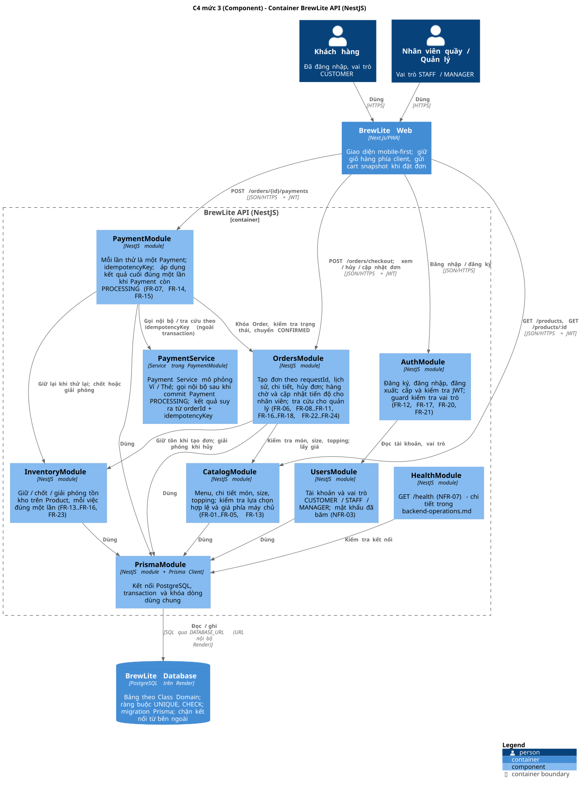

# Thiết kế backend và dữ liệu (Task 3.1)

> **Ký hiệu nguồn:** **[Đề]** = Assignment2-BrewLite.pdf; **[Task trước]** = SRS, UC-01, sơ đồ Task 2 đã chốt; **[Đề xuất]** = lựa chọn của nhóm, đề không quy định.

## 1. Phạm vi tài liệu

- Tài liệu mô tả container **BrewLite API (NestJS)** ở mức C4 Component và container **BrewLite Database (PostgreSQL)**: schema, ràng buộc, transaction, migration. **[Đề]** mục 5.1: "backend NestJS theo module/domain; PostgreSQL và cơ chế migration".
- Mức C4 Context và Container nằm trong `architecture-overview.md`. Frontend nằm trong `frontend-architecture.md`. Payment Service mô phỏng, logging, health check và cấu hình nằm trong `backend-operations.md`.
- Mô hình dữ liệu lấy theo **Class Domain** (`docs/diagrams/class-domain.puml`); tài liệu này không thêm ERD. **[Task trước]**

Tên container dùng chung: **BrewLite Web** (Next.js/PWA), **BrewLite API** (NestJS), **BrewLite Database** (PostgreSQL), thống nhất với `backend-operations.md`; Hoàng đồng bộ trong tài liệu C4. **[Đề xuất]** (đề không quy định tên).

Payment Service mô phỏng là **PaymentService trong PaymentModule**, chạy cùng tiến trình với BrewLite API, không phải container riêng. Chi tiết bộ mô phỏng nằm trong `backend-operations.md`. Đề 5.1 chỉ yêu cầu có "dịch vụ thanh toán mô phỏng", không bắt buộc tách dịch vụ riêng. **[Đề]**

## 2. Sơ đồ C4 Component của API

Tệp nguồn: [`c4-component-api.puml`](c4-component-api.puml)

## 3. Các module NestJS

Các module chia theo domain của SRS. **[Đề]** mục 5.1, **[Task trước]** SRS, Class Domain.

| Module | Trách nhiệm | Phụ thuộc | FR / NFR | Thư mục dự kiến |
|---|---|---|---|---|
| AuthModule | Đăng ký, đăng nhập, đăng xuất; cấp JWT trong cookie `HttpOnly` và kiểm tra JWT; guard đọc JWT từ cookie, kiểm tra vai trò trên mọi API bảo vệ (401/403); thu hồi token khi đăng xuất | UsersModule | FR-12, FR-17, FR-20, FR-21, NFR-02 | `apps/api/src/auth` |
| UsersModule | Tài khoản, vai trò `CUSTOMER` / `STAFF` / `MANAGER`; lưu mật khẩu đã băm | PrismaModule | FR-20, FR-21, NFR-03 | `apps/api/src/users` |
| CatalogModule | Menu, chi tiết món, size, topping; nhãn hết hàng; kiểm tra lựa chọn hợp lệ và tính giá phía máy chủ | PrismaModule | FR-01..FR-05, FR-13, NFR-04 | `apps/api/src/catalog` |
| InventoryModule | Giữ, chốt, giải phóng tồn kho trên Product; mỗi thao tác chỉ một lần theo `stockHoldStatus` | PrismaModule | FR-13..FR-16, FR-23 | `apps/api/src/inventory` |
| OrdersModule | Tạo đơn theo `requestId`; lịch sử, chi tiết, hủy đơn của khách; hàng chờ và cập nhật tiến độ cho nhân viên; tra cứu cho quản lý | CatalogModule, InventoryModule, PrismaModule | FR-06, FR-08..FR-11, FR-16..FR-18, FR-22..FR-24 | `apps/api/src/orders` |
| PaymentModule | Mỗi lần thử thanh toán là một Payment; chống xử lý trùng bằng `idempotencyKey`; áp dụng kết quả cuối đúng một lần khi Payment còn `PROCESSING`; chứa `PaymentService` (bộ mô phỏng Ví/Thẻ, gọi nội bộ, chi tiết trong `backend-operations.md`) | OrdersModule, InventoryModule, PrismaModule | FR-07, FR-14, FR-15 | `apps/api/src/payment` |
| PrismaModule | Kết nối PostgreSQL; transaction và khóa dòng dùng chung | BrewLite Database | NFR-08 | `apps/api/src/prisma` |
| HealthModule | `GET /health`; chi tiết thuộc phần operations | PrismaModule | NFR-07 | `apps/api/src/health` |

Ghi chú:
- **Giỏ hàng nằm phía client.** Class Domain không có lớp Cart, và Sequence Checkout gửi `cart snapshot` kèm `POST /orders/checkout`. Vì vậy API không có module giỏ hàng: thêm, sửa, xóa món trong giỏ (FR-04, FR-05, FR-19) do BrewLite Web xử lý, dùng dữ liệu món, size, topping từ CatalogModule; mọi dữ liệu giỏ được API kiểm tra lại khi tạo đơn (FR-13). **[Task trước]**
- Endpoint đã có trong tài liệu trước: `GET /products`, `GET /products/:id`, `GET /health` (SRS, NFR-01, NFR-07); `POST /auth/login`, `POST /orders/checkout`, `POST /orders/{id}/payments` (Sequence). Các endpoint còn lại đặt tên khi làm Task 4. **[Task trước]**
- **JWT theo [ADR-001](adr/001-frontend-architecture.md)** (thống nhất với Phúc). **[Đề xuất]** Đề chỉ yêu cầu JWT, không quy định cách lưu.
  - `POST /auth/login` đặt cookie `HttpOnly; Secure; SameSite=Lax; Path=/`. JWT sống 30 phút, có claim `jti`, không dùng refresh token. Body chỉ trả `user` và `role`.
  - Trình duyệt gọi qua proxy `/api/*` của BrewLite Web, nên cookie cùng origin với Web.
  - `GET /auth/me` trả user và role. `POST /auth/logout` xóa cookie và đưa `jti` vào danh sách thu hồi đến khi token hết hạn; token cũ bị 401 (FR-21).
  - Danh sách thu hồi giữ **trong bộ nhớ** BrewLite API, không thêm bảng ngoài Class Domain. Đánh đổi: API khởi động lại thì danh sách mất, token cũ dùng lại được tối đa 30 phút; MVP chạy một instance nên chấp nhận được.
- `PaymentModule` phụ thuộc `OrdersModule`, không có chiều ngược lại. Riêng khi hủy đơn (FR-23), `OrdersModule` đọc bảng `payments` trong cùng transaction để kiểm tra lần thanh toán **Đang xử lý**. Nhóm chấp nhận đánh đổi này (xem mục 7) để tránh hai module phụ thuộc vòng. **[Đề xuất]**

## 4. Database PostgreSQL

### 4.1. Bảng

Các bảng lấy theo Class Domain. **[Task trước]**

| Bảng | Lớp trong Class Domain | Ghi chú |
|---|---|---|
| `users` | User | |
| `products` | Product | Lưu `stock_quantity`, `reserved_quantity`; `availableQuantity` là giá trị tính ra, không lưu |
| `sizes`, `toppings` | Size, Topping | Size dùng chung cho cả cửa hàng |
| `product_sizes`, `product_toppings` | Quan hệ Product – Size, Product – Topping (0..* – 0..*) | Bảng nối |
| `orders` | Order | |
| `order_items` | OrderItem | Lưu giá tại thời điểm đặt |
| `order_item_toppings` | OrderItemTopping | Lưu giá topping tại thời điểm đặt |
| `payments` | Payment | Mỗi lần thử thanh toán là một dòng |

`Promotion` và `LoyaltyTransaction` thuộc phạm vi mở rộng, **không tạo bảng trong MVP**. **[Task trước]** SRS mục 2, Class Domain.

### 4.2. Trạng thái

Lưu bằng kiểu enum của PostgreSQL, tên giá trị giữ đúng như Class Domain. **[Task trước]**

| Enum | Giá trị | Cột |
|---|---|---|
| `OrderStatus` | `PENDING_PAYMENT`, `CONFIRMED`, `PREPARING`, `READY`, `COMPLETED`, `CANCELLED` | `orders.status` |
| `PaymentStatus` | `PROCESSING`, `SUCCEEDED`, `FAILED` | `payments.status` |
| `StockHoldStatus` | `HELD`, `COMMITTED`, `RELEASED` | `orders.stock_hold_status` |
| `PaymentMethod` | `WALLET`, `CARD` | `payments.method` |
| `UserRole` | `CUSTOMER`, `STAFF`, `MANAGER` | `users.role` |

### 4.3. Ràng buộc

| Ràng buộc | Mục đích | Nguồn |
|---|---|---|
| `UNIQUE (user_id, request_id)` trên `orders` | Gửi lại cùng một lần xác nhận đặt đơn chỉ tạo một đơn (E4) | [Task trước] FR-18, Class, Sequence |
| `UNIQUE (order_id, idempotency_key)` trên `payments` | Cùng khóa trên cùng đơn chỉ tạo và xử lý một Payment (E7) | [Task trước] FR-15, Class, Sequence |
| `UNIQUE (email)` trên `users` | Không đăng ký trùng email | [Task trước] FR-20 |
| `UNIQUE (order_code)` trên `orders` | Mã đơn duy nhất | [Task trước] FR-06 |
| `CHECK (stock_quantity >= 0 AND reserved_quantity >= 0 AND reserved_quantity <= stock_quantity)` | Tồn kho không âm, không giữ quá số tồn | [Task trước] FR-13 (6); [Đề xuất] cách cài đặt |
| `CHECK (quantity >= 1)` trên `order_items` | Không có dòng món số lượng 0 | [Task trước] FR-13 (1); [Đề xuất] cách cài đặt |

Chỉ mục: `orders (status)` cho hàng chờ nhân viên và lọc của quản lý (FR-09, FR-11); `orders (user_id, created_at)` cho lịch sử đơn (FR-08). **[Đề xuất]**

## 5. Transaction và chống xử lý trùng

Mỗi thao tác dưới đây làm đúng theo Sequence Checkout và SRS. **[Task trước]**

| Thao tác | Trong một transaction | Chống trùng / cạnh tranh |
|---|---|---|
| Tạo đơn (FR-06, FR-16, FR-18) | Khóa dòng `products` liên quan, kiểm tra `availableQuantity`; tạo `orders` (`PENDING_PAYMENT`, `HELD`) và `order_items`; tăng `reserved_quantity` | Tra `requestId` của khách trước; vi phạm `UNIQUE (user_id, request_id)` thì hoàn tác và trả đơn đã có |
| Bắt đầu thanh toán (FR-07, FR-14) | Theo thứ tự: (1) khóa dòng `orders`; (2) tra lại Payment theo cùng khóa (`orderId`, `idempotencyKey`); (3) nếu tìm thấy thì kết thúc transaction và trả Payment hiện có; (4) nếu chưa có thì mới xét điều kiện tạo mới: đơn còn `PENDING_PAYMENT`, chưa có Payment `PROCESSING`, nếu `RELEASED` thì giữ lại tồn (`RELEASED → HELD`); (5) tạo `payments` (`PROCESSING`) và commit | Tra khóa **trước** khi xét trạng thái đơn, để gửi lại sau khi đã thành công vẫn nhận kết quả cũ (E7); vi phạm `UNIQUE (order_id, idempotency_key)` thì hoàn tác và trả Payment đã có |
| Gọi PaymentService (gọi nội bộ) | **Ngoài transaction**, sau khi commit Payment `PROCESSING` | Gửi lại hoặc tra cứu bằng cùng `idempotencyKey` (FR-15, E6); bộ mô phỏng tái hiện cùng kết quả từ `orderId` và `idempotencyKey`, nên không cần thêm bảng |
| Áp dụng kết quả (FR-07, FR-14, FR-15) | Chỉ khi Payment còn `PROCESSING`: thành công thì `SUCCEEDED`, `COMMITTED`, `CONFIRMED`, giảm `stock_quantity` và `reserved_quantity`; thất bại thì `FAILED`, `RELEASED`, giảm `reserved_quantity` | Điều kiện trạng thái bảo đảm chốt hoặc giải phóng đúng một lần |
| Hủy đơn (FR-23, FR-24) | Khóa dòng `orders`; chỉ khi `PENDING_PAYMENT` và không có Payment `PROCESSING`: chuyển `CANCELLED`, giải phóng tồn nếu còn `HELD` | Thanh toán và hủy cùng khóa dòng `orders`, nên chỉ một thao tác được chấp nhận |
| Cập nhật tiến độ (FR-10, FR-17) | Cập nhật có điều kiện theo trạng thái cũ (`WHERE status = trạng thái hiện tại`) | Hai nhân viên cùng cập nhật thì chỉ một yêu cầu được ghi |

Khóa các dòng `products` theo thứ tự `id` tăng dần để hai đơn đồng thời không chờ nhau vòng tròn (deadlock). **[Đề xuất]**

## 6. Migration và seed

| Nội dung | Mô tả | Nguồn |
|---|---|---|
| Cơ chế migration | Mỗi thay đổi schema là một file migration SQL, commit vào repo để có lịch sử rõ ràng | [Đề] mục 5.1; mục 1 "có lịch sử thay đổi rõ ràng" |
| Công cụ | **Prisma Migrate**; schema tại `apps/api/prisma/schema.prisma`, migration tại `apps/api/prisma/migrations/` | [Đề xuất], xem [ADR-002](adr/002-database-postgresql-prisma.md) |
| Local | `docker-compose` chạy PostgreSQL; lập trình viên tạo migration bằng `prisma migrate dev` | [Task trước] NFR-06; [Đề xuất] lệnh |
| Production | BrewLite Database là **Render Postgres**, chặn kết nối từ bên ngoài; BrewLite API kết nối qua `DATABASE_URL` (URL nội bộ, thống nhất với `backend-operations.md`); chạy `prisma migrate deploy` mỗi lần deploy API, trước khi API nhận request | [Đề] mục 5.2; nhóm chọn Render; [Đề xuất] tên biến, thời điểm chạy |
| Seed | Tồn kho ban đầu, món, size, topping, tài khoản nhân viên và quản lý nạp từ `apps/api/prisma/seed.ts`. Seed chạy riêng, **không chạy lại mỗi lần deploy**, để không ghi đè tồn kho thật. Vì database chặn kết nối từ bên ngoài, seed production chạy **từ dịch vụ BrewLite API trên Render** (shell hoặc lệnh chạy một lần), không chạy từ máy cá nhân | [Task trước] SRS "tồn kho nạp từ seed"; [Đề xuất] cách chạy |

Cần kiểm tra trước khi chốt:
- Gói Render nhóm dùng có hỗ trợ lệnh chạy trước khi deploy (pre-deploy) không. Nếu không, chạy migration ở đầu lệnh khởi động API.
- Render Postgres bản miễn phí có giới hạn thời hạn không. Đề mục 8 ghi: không có URL production hoạt động lúc chấm thì phần triển khai không được tính.

## 7. Lý do chọn, ưu điểm, hạn chế, trade-off

Mục này đáp ứng yêu cầu **[Đề]** mục 5.1: "lý do chọn kiến trúc, ưu điểm, hạn chế và trade-off".

| Quyết định | Lý do / ưu điểm | Hạn chế / trade-off |
|---|---|---|
| Chia module NestJS theo domain | Mỗi module ứng với một nhóm FR, dễ phân công và truy vết | Các module phụ thuộc nhau (Orders, Payment, Inventory); cần giữ chiều phụ thuộc một hướng |
| Tách `InventoryModule` | Logic giữ, chốt, giải phóng tồn dùng ở 3 nơi (tạo đơn, thanh toán, hủy) được gom một chỗ, giảm nguy cơ cập nhật tồn hai lần | Thêm một module nhỏ; transaction phải truyền qua giữa các module |
| Đọc `payments` từ `OrdersModule` khi hủy đơn | Tránh phụ thuộc vòng Orders ↔ Payment | Orders biết một phần dữ liệu của Payment |
| Khóa dòng (`SELECT ... FOR UPDATE`) cho tồn kho và đơn | Đúng tuyệt đối khi đặt đơn hoặc thanh toán đồng thời (FR-13 (6), FR-23) | Các yêu cầu cùng món phải chờ nhau; chấp nhận được với quy mô một cửa hàng |
| Ràng buộc UNIQUE ở database thay vì chỉ kiểm tra trong code | Chặn được hai request đến cùng lúc (FR-15, FR-18) | Code phải bắt lỗi vi phạm UNIQUE và trả kết quả cũ |
| Gọi PaymentService ngoài transaction | Không giữ khóa database trong lúc chờ bộ mô phỏng trả kết quả | Có khoảng Payment ở `PROCESSING`; xử lý bằng tra cứu lại cùng khóa (E6) |
| Prisma | Schema dễ đọc, gần Class Domain; migration là file SQL có lịch sử | Khóa dòng `FOR UPDATE` phải viết SQL thô (`$queryRaw`) trong transaction |
| Render Postgres | Cùng nền tảng nhóm đã chọn cho production; có lưu trữ bền vững, kết nối nội bộ với API | Phụ thuộc giới hạn của gói Render nhóm dùng |

## 8. Truy vết

| Thành phần | Yêu cầu | Sơ đồ Task 2 | Mã nguồn dự kiến |
|---|---|---|---|
| AuthModule, UsersModule | FR-12, FR-17, FR-20, FR-21, NFR-02, NFR-03 | Sequence (phần 1), Activity khách hàng | `apps/api/src/auth`, `apps/api/src/users` |
| CatalogModule | FR-01..FR-05, FR-13 | Activity khách hàng; Class: Product, Size, Topping | `apps/api/src/catalog` |
| InventoryModule | FR-13..FR-16, FR-23 | Sequence (phần 2, 3); Class: `StockHoldStatus` | `apps/api/src/inventory` |
| OrdersModule | FR-06, FR-08..FR-11, FR-16..FR-18, FR-22..FR-24 | Sequence (phần 2), Activity checkout, Activity tổng thể; Class: Order, OrderItem | `apps/api/src/orders` |
| PaymentModule (gồm PaymentService) | FR-07, FR-14, FR-15 | Sequence (phần 3; lifeline Payment Service là lời gọi nội bộ), Activity checkout; Class: Payment | `apps/api/src/payment` |
| BrewLite Database (PostgreSQL) | NFR-06, NFR-08 | Class Domain | `apps/api/prisma/schema.prisma`, `apps/api/prisma/migrations/`, `apps/api/prisma/seed.ts` |

Cột mã nguồn sẽ cập nhật đường dẫn thật khi làm Task 4–5.
