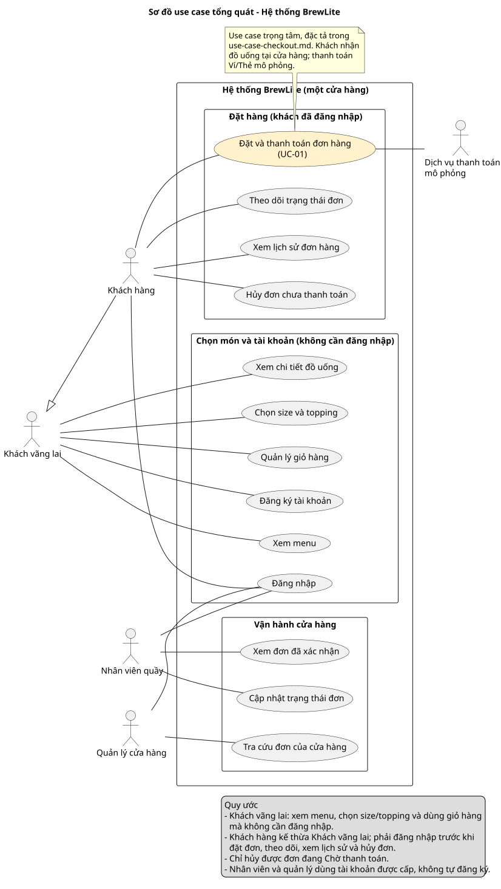

# BrewLite – Software Requirements Specification (SRS) rút gọn

## 1. Yêu cầu chức năng (Functional Requirements)

| ID | MoSCoW | Tác nhân | Yêu cầu chức năng | Tiêu chí chấp nhận |
|---|---|---|---|---|
| FR-01 | Must | Khách hàng | Xem danh sách đồ uống đang được bán tại BrewLite. | Khách đã đăng nhập thấy tên và giá bán từng sản phẩm; hiển thị ảnh nếu có; sản phẩm ngừng kinh doanh không thể đặt mua. Khi số lượng có thể bán của một món bằng 0, menu vẫn hiển thị món đó với nhãn hết hàng. Khi chưa đăng nhập, hệ thống chuyển khách tới trang đăng nhập và không trả danh sách đồ uống. |
| FR-02 | Must | Khách hàng | Xem thông tin chi tiết của đồ uống được chọn. | Hiển thị tên, mô tả và giá sản phẩm; hiển thị các tùy chọn size, topping nếu có; thông báo phù hợp khi sản phẩm không tồn tại. |
| FR-03 | Must | Khách hàng | Chọn size và topping phù hợp với sản phẩm trước khi thêm vào giỏ. | Hiển thị các tùy chọn được phép chọn; cập nhật giá theo lựa chọn; từ chối tùy chọn không hợp lệ; lưu đúng lựa chọn vào giỏ hàng. |
| FR-04 | Must | Khách hàng | Thêm đồ uống vào giỏ hàng với số lượng, size và topping đã chọn. | Thêm được sản phẩm đang kinh doanh; lưu đúng số lượng, size và topping; tính đúng giá; hiển thị thông báo thành công; từ chối sản phẩm hoặc dữ liệu không hợp lệ. |
| FR-05 | Must | Khách hàng | Khách hàng có thể sửa trực tiếp số lượng, size và topping của từng dòng món trong giỏ hàng. Hệ thống lưu thay đổi vào dòng món được chọn và tính lại thành tiền của dòng món và tổng tiền giỏ hàng. | Khi khách lưu số lượng, size hoặc topping hợp lệ, giỏ hàng hiển thị đúng các thay đổi trên dòng món được chọn và cập nhật đúng số tiền theo lựa chọn mới. Các dòng món khác giữ nguyên. Nếu số lượng nhỏ hơn 1, vượt giới hạn cho phép hoặc size/topping không hợp lệ với món, hệ thống báo lỗi và giữ dữ liệu đã lưu trước đó. |
| FR-06 | Must | Khách hàng | Xác nhận đặt đơn từ giỏ hàng. Hệ thống kiểm tra phiên đăng nhập, món, size, topping, số lượng và tồn kho. Tổng tiền được tính theo dữ liệu phía máy chủ. | Với giỏ hợp lệ và đủ hàng, khi khách xác nhận, hệ thống tạo một đơn Chờ thanh toán có mã duy nhất và hiển thị danh sách món, tùy chọn, số lượng, tổng tiền. Nếu dữ liệu không hợp lệ, hệ thống chỉ ra mục cần sửa. Khi tạo đơn không thành công, không để lại dữ liệu đơn hàng không nhất quán (đối chiếu FR-16). |
| FR-07 | Must | Khách hàng | Thanh toán đơn bằng Ví mô phỏng hoặc Thẻ mô phỏng. Dịch vụ mô phỏng hỗ trợ kết quả thành công và thất bại có thể tái hiện khi kiểm thử. | Chạy kịch bản thành công với từng phương thức. Hệ thống ghi nhận thanh toán Thành công, chuyển đơn sang Đã xác nhận, hiển thị mã đơn và đưa đơn vào danh sách xử lý của nhân viên. Có thể thử kịch bản thất bại và xử lý theo FR-14; yêu cầu gửi lại cùng khóa không tạo xử lý trùng theo FR-15. |
| FR-08 | Must | Khách hàng | Theo dõi trạng thái hiện tại và xem lịch sử đơn của mình. | Sau khi nhân viên đổi trạng thái hợp lệ, khách mở lại chi tiết đơn và thấy trạng thái mới. Khi khách truy cập trực tiếp mã đơn thuộc tài khoản khác, hệ thống từ chối và không trả chi tiết đơn. Danh sách lịch sử chỉ gồm đơn của tài khoản đăng nhập; mỗi đơn hiển thị mã, thời điểm tạo, tổng tiền, trạng thái và có thể mở chi tiết; trường hợp không có đơn hiển thị thông báo phù hợp. |
| FR-09 | Must | Nhân viên quầy | Xem danh sách và chi tiết các đơn đã xác nhận để chuẩn bị món. | Khi có một đơn đã xác nhận và một đơn thanh toán thất bại, danh sách xử lý chỉ hiển thị đơn đã xác nhận. Chi tiết hiển thị món, size, topping và số lượng. |
| FR-10 | Must | Nhân viên quầy | Cập nhật tiến độ đơn theo thứ tự Đã xác nhận → Đang chuẩn bị → Sẵn sàng nhận → Hoàn tất. | Khi cập nhật sang bước kế tiếp, hệ thống lưu và hiển thị trạng thái mới. Khi yêu cầu bỏ bước hoặc cập nhật đơn chưa thanh toán, hệ thống từ chối. |
| FR-11 | Should | Quản lý | Tra cứu các đơn của cửa hàng, gồm cả đơn chờ thanh toán và đơn có lần thanh toán thất bại. Lọc theo trạng thái đơn. | Khi chọn Chờ thanh toán, danh sách chỉ trả các đơn ở trạng thái đó. Khi mở một đơn có lần thanh toán thất bại, quản lý thấy kết quả của lần thanh toán đó trong chi tiết. |
| FR-12 | Must | Khách hàng / Hệ thống | Chưa đăng nhập hoặc JWT hết hạn. Giao diện yêu cầu đăng nhập lại và giữ giỏ hàng. Backend kiểm tra phiên trước khi tạo đơn hoặc xử lý thanh toán. | Gửi yêu cầu đặt đơn hoặc thanh toán bằng JWT hết hạn. Backend từ chối, không tạo đơn hoặc lần thanh toán mới. Sau khi đăng nhập lại, khách thấy các món đã chọn trong giỏ. |
| FR-13 | Must | Khách hàng / Hệ thống | Giỏ trống, tùy chọn sai hoặc hết hàng. Frontend báo lỗi dữ liệu có thể phát hiện tại chỗ. Backend kiểm tra lại dữ liệu và tồn kho, xác định dòng cần sửa và giữ các lựa chọn còn lại. | (1) Thử số lượng bằng 0, topping không hợp lệ và số lượng vượt tồn kho: mỗi lần gửi đều bị từ chối, khách thấy mục cần sửa, không có đơn mới và không có tồn kho bị giữ dở dang. (2) Món còn hàng lúc khách thêm vào giỏ nhưng hết hàng trước khi khách xác nhận đặt đơn: backend từ chối tạo đơn, giao diện báo món nào đã hết, giỏ vẫn giữ các món và tùy chọn đã chọn, hệ thống không giữ tồn kho cho yêu cầu bị từ chối. (3) Khách đặt 3 ly nhưng chỉ còn 2 ly: giao diện báo món không đủ số lượng và cho khách quay lại giỏ để giảm số lượng hoặc xóa món. (4) Khách thử thanh toán lại sau một lần thất bại nhưng món đã hết hàng: hệ thống báo hết hàng, không bắt đầu lần thanh toán mới và giữ đơn ở Chờ thanh toán. (5) Trà đào có tồn kho mẫu 10 ly; sau khi các đơn thanh toán thành công mua đủ 10 ly, khách tiếp theo đặt thêm 1 ly nhận thông báo Trà đào đã hết hàng, giỏ được giữ và không có đơn mới. (6) Trà đào còn 1 ly, hai khách xác nhận đặt đơn cùng lúc: chỉ một đơn được tạo và giữ tồn kho, khách còn lại nhận thông báo hết hàng, tồn kho không bị âm. |
| FR-14 | Must | Khách hàng / Hệ thống | Thanh toán mô phỏng thất bại. Ghi nhận lần thử Thất bại, báo cho khách và cho phép thử lại trên cùng đơn. Mỗi lần thử chủ động sau một thất bại đã xác định dùng mã yêu cầu mới. | Mô phỏng lần đầu thất bại, lần sau thành công. Sau lần đầu, tồn kho được giải phóng và đơn chưa xuất hiện ở hàng chờ nhân viên. Sau lần hai, mã đơn giữ nguyên, có hai lần thử với kết quả tương ứng và đơn được xác nhận đúng một lần. |
| FR-15 | Must | Khách hàng / Hệ thống | Mất kết nối, hết thời gian chờ hoặc gửi trùng yêu cầu thanh toán. Hệ thống tra cứu hoặc gửi lại với cùng khóa chống xử lý trùng (idempotency key) để lấy kết quả của lần đang xử lý. | Gửi đồng thời hai yêu cầu thanh toán cùng khóa hoặc gửi lại sau khi mất phản hồi. Hệ thống chỉ xử lý một lần thanh toán cho khóa đó và chỉ chốt tồn kho một lần. Khi kết quả chưa xác định, giao diện hiển thị Đang xử lý. |
| FR-16 | Must | Khách hàng / Hệ thống | Lỗi khi lưu đơn hoặc giữ tồn kho. Hệ thống hoàn tác các thay đổi của lần tạo đơn bị lỗi, báo khách và giữ giỏ để khách thử lại. | Giả lập lỗi sau khi ghi đơn nhưng trước khi hoàn tất giữ tồn kho. Sau lỗi, không có đơn lưu dở, tồn kho khớp với trước thao tác và giỏ hàng vẫn có các món đã chọn. |
| FR-17 | Must | Khách hàng / Hệ thống | Sai quyền hoặc trạng thái đã thay đổi. Backend kiểm tra vai trò và trạng thái hiện tại trước khi ghi cập nhật. Nếu dữ liệu trên màn hình đã cũ, giao diện tải lại trạng thái mới nhất. | Khách gọi trực tiếp thao tác dành cho nhân viên thì bị từ chối. Hai nhân viên cùng cập nhật từ một trạng thái cũ thì chỉ một yêu cầu được ghi nhận. Yêu cầu còn lại nhận trạng thái mới nhất để đồng bộ màn hình. |
| FR-18 | Must | Khách hàng / Hệ thống | Gửi lại yêu cầu đặt đơn. Hệ thống nhận diện cùng một lần xác nhận đặt đơn bằng mã yêu cầu, kể cả khi khách gửi lại vì mất phản hồi. | Gửi hai yêu cầu tạo đơn đồng thời với cùng mã yêu cầu và cùng nội dung. Hệ thống trả cùng mã đơn, chỉ tạo một đơn và chỉ giữ tồn kho một lần. |
| FR-19 | Must | Khách hàng | Xóa sản phẩm khỏi giỏ hàng. | Xóa đúng sản phẩm được chọn; tính lại tổng tiền; hiển thị trạng thái giỏ hàng trống khi không còn sản phẩm. |
| FR-20 | Must | Khách hàng | Đăng ký tài khoản để sử dụng các chức năng dành cho người dùng đã đăng ký. | Kiểm tra trường bắt buộc và dữ liệu hợp lệ; từ chối email đã tồn tại; mật khẩu không lưu dạng văn bản thuần; thông báo đăng ký thành công hoặc thất bại. |
| FR-21 | Must | Khách hàng | Đăng nhập bằng tài khoản đã đăng ký và đăng xuất an toàn. | Đăng nhập thành công với thông tin hợp lệ; từ chối thông tin sai và hiển thị thông báo phù hợp; chỉ truy cập chức năng đúng quyền; phiên đăng nhập không còn dùng được để truy cập tài nguyên bảo vệ sau khi đăng xuất. |
| FR-22 | Must | Khách hàng | Cung cấp và xác nhận thông tin cần thiết khi đặt hàng. | Hiển thị biểu mẫu và thông tin đơn trước khi xác nhận; kiểm tra các trường bắt buộc; không cho tiếp tục khi dữ liệu không hợp lệ. |
| FR-23 | Must | Khách hàng / Hệ thống | Khách hàng có thể hủy đơn của mình khi đơn ở trạng thái Chờ thanh toán và không có lần thanh toán Đang xử lý. Khi hủy thành công, hệ thống chuyển đơn sang Đã hủy và giải phóng phần tồn kho còn giữ. | Với đơn đủ điều kiện, khi khách xác nhận hủy, hệ thống lưu Đã hủy và giải phóng tồn kho còn giữ đúng một lần. Nếu tồn kho đã được giải phóng sau lần thanh toán thất bại, số lượng tồn không tăng thêm. Yêu cầu hủy đơn của người khác, đơn đã xác nhận hoặc đơn đang xử lý thanh toán bị từ chối. Nếu hủy và bắt đầu thanh toán được gửi đồng thời, chỉ một thao tác được chấp nhận. |
| FR-24 | Must | Khách hàng / Hệ thống | Hiển thị Đã hủy trong lịch sử và chi tiết đơn của khách. Đã hủy là trạng thái cuối. | Sau khi tải lại lịch sử và chi tiết, khách vẫn thấy cùng mã đơn với trạng thái Đã hủy. Đơn không xuất hiện trong hàng chờ xử lý của nhân viên. Khi gửi yêu cầu thanh toán mới hoặc cập nhật tiến độ cho đơn này, hệ thống từ chối và đơn vẫn ở Đã hủy. |

## 2. Quy tắc nghiệp vụ về trạng thái, thanh toán và tồn kho

- **Quyền truy cập:** Khách hàng phải đăng nhập mới xem được menu, chọn món, dùng giỏ hàng, đặt đơn, thanh toán và xem đơn. Khi chưa đăng nhập, khách chỉ có thể đăng ký hoặc đăng nhập. Nhân viên quầy và quản lý dùng tài khoản được cấp.
- **Hình thức nhận đồ uống:** Khách nhận tại quầy của cửa hàng; không hỗ trợ giao hàng.
- **Trạng thái đơn:** Chờ thanh toán → Đã xác nhận → Đang chuẩn bị → Sẵn sàng nhận → Hoàn tất. Không được bỏ qua bước; đơn chưa thanh toán không thể vào luồng chuẩn bị.
- **Trạng thái từng lần thanh toán:** Đang xử lý, Thành công, Thất bại. Thanh toán thất bại không đổi mã đơn, đơn vẫn Chờ thanh toán và có thể thử lại.
- **Tồn kho:** Số lượng tồn kho ban đầu của mỗi món được nạp từ dữ liệu mẫu (seed) và tính theo từng đồ uống. Khi tạo đơn, hệ thống giữ số lượng khách đặt; tạo đơn và giữ tồn kho phải cùng thành công hoặc cùng hoàn tác. Thanh toán thành công thì chốt số lượng đã giữ. Thanh toán thất bại hoặc khách hủy đơn hợp lệ thì giải phóng phần còn giữ. Khi khách thanh toán lại, hệ thống kiểm tra và giữ lại tồn kho trước khi thanh toán. Khi số lượng có thể bán bằng 0, hệ thống báo hết hàng. Trong MVP, hệ thống không tự giải phóng tồn kho theo thời gian; phần đã giữ chỉ được chốt hoặc giải phóng theo các sự kiện trên.
- **Chống xử lý trùng:** Mỗi lần xác nhận đơn hoặc thanh toán dùng mã yêu cầu/khóa phù hợp; gửi lại cùng một yêu cầu không tạo thêm đơn, giao dịch hoặc thay đổi tồn kho trùng.
- **Hủy đơn:** Chờ thanh toán → Đã hủy theo điều kiện của FR-23. Việc chuyển trạng thái và giải phóng tồn kho còn giữ phải cùng thành công hoặc cùng hoàn tác.
- **Phạm vi mở rộng:** Promotion (khuyến mãi) và LoyaltyTransaction (tích điểm) thuộc phạm vi mở rộng, chỉ có trong mô hình domain, không hiện thực trong MVP.

## 3. Yêu cầu phi chức năng (NFR)

| ID | MoSCoW | Yêu cầu | Tiêu chí chấp nhận |
|---|---|---|---|
| NFR-01 | Must | Hiệu năng API | Với dữ liệu seed, chạy bằng `docker-compose` ở môi trường local, các API `GET /products`, `GET /products/:id`, tạo đơn và thanh toán có thời gian phản hồi p95 dưới 500 ms qua 100 lần gọi liên tiếp. |
| NFR-02 | Must | Bảo mật xác thực | Backend xác thực JWT với API bảo vệ, phân quyền khách/nhân viên/quản lý; gọi API bảo vệ không kèm JWT hoặc sai vai trò nhận phản hồi từ chối (401/403) và không thấy dữ liệu nhạy cảm. |
| NFR-03 | Must | Bảo vệ dữ liệu tài khoản | Mật khẩu được băm, không xuất hiện dưới dạng văn bản thuần trong cơ sở dữ liệu hoặc log. |
| NFR-04 | Must | Kiểm tra dữ liệu | Backend từ chối size, topping, số lượng, mã đơn hoặc trạng thái không hợp lệ và trả lỗi có thể xử lý. |
| NFR-05 | Must | Tính khả dụng | Giao diện có trạng thái đang tải, lỗi và dữ liệu rỗng; đi hết luồng xem menu → đặt đơn → thanh toán → theo dõi đơn được trên màn hình rộng 375 px mà không phải cuộn ngang. |
| NFR-06 | Must | Khả năng triển khai | Ứng dụng dùng Next.js, NestJS, PostgreSQL; có `.env.example`, hướng dẫn khởi động trong README và `docker-compose.yml` chạy được web, API và database ở local. |
| NFR-07 | Should | Quan sát hệ thống | Backend ghi log lỗi và trạng thái khởi động; `GET /health` trả mã 200 khi API và database hoạt động. |
| NFR-08 | Must | Tính toàn vẹn dữ liệu | Yêu cầu tạo đơn, giữ tồn kho và thanh toán không để lại cập nhật dở dang hoặc xử lý trùng trong kịch bản kiểm thử. |

## 4. Use-case tổng quát

Tệp nguồn: [`../diagrams/usecase-overview.puml`](../diagrams/usecase-overview.puml). Đặc tả use case trọng tâm: [`use-case-checkout.md`](use-case-checkout.md).

- **Khách hàng:** Đăng ký; Đăng nhập; Xem menu; Xem chi tiết; Chọn size/topping; Quản lý giỏ; Đặt và thanh toán đơn hàng; Theo dõi trạng thái đơn; Xem lịch sử đơn; Hủy đơn chưa thanh toán.
- **Nhân viên quầy:** Đăng nhập; Xem đơn đã xác nhận; Cập nhật trạng thái đơn.
- **Quản lý:** Đăng nhập; Tra cứu đơn.
- **Dịch vụ thanh toán mô phỏng:** Phản hồi thành công/thất bại; hỗ trợ xử lý gửi lại yêu cầu.

## 5. Bảng truy vết phạm vi MVP → FR

| MVP | FR tương ứng |
|---|---|
| MVP-01 Xem menu | FR-01 |
| MVP-02 Chi tiết sản phẩm | FR-02 |
| MVP-03 Size/topping | FR-03 |
| MVP-04 Giỏ hàng | FR-04, FR-05, FR-19 |
| MVP-05 Xác thực | FR-20, FR-21, FR-12 |
| MVP-06 Đặt hàng | FR-06, FR-13, FR-16, FR-18, FR-22 |
| MVP-07 Thanh toán mô phỏng | FR-07, FR-14, FR-15 |
| MVP-08 Xác nhận đơn | FR-06, FR-07 |
| MVP-09 Theo dõi trạng thái và hủy đơn | FR-08, FR-23, FR-24 |
| MVP-10 Lịch sử đơn | FR-08, FR-24 |
| MVP-11 Xử lý tại quầy | FR-09, FR-10, FR-17 |