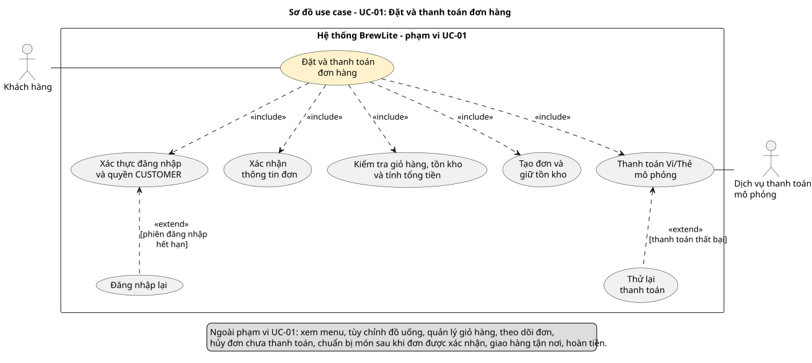

# Đặc tả use case UC-01 — Đặt và thanh toán đơn hàng

## 1. Use-case diagram

Tệp nguồn: [`../diagrams/usecase-checkout.puml`](../diagrams/usecase-checkout.puml)

## 2. Actor

| Actor | Loại | Vai trò trong use case |
|---|---|---|
| Khách hàng | Actor chính | Đã đăng nhập với vai trò `CUSTOMER`; xác nhận đặt đơn từ giỏ hàng và thanh toán. |
| Dịch vụ thanh toán mô phỏng | Actor phụ | Nhận yêu cầu thanh toán Ví/Thẻ mô phỏng và trả kết quả thành công hoặc thất bại. |

## 3. Trigger

Khách hàng chọn **Đặt hàng** tại trang giỏ hàng.

## 4. Tiền điều kiện

1. Khách hàng đã đăng nhập với vai trò `CUSTOMER` (nhóm quy định phải đăng nhập mới xem được menu và đặt món).
2. Khách hàng đang ở trang giỏ hàng; giỏ hàng có ít nhất một món kèm tùy chọn đã chọn.

## 5. Hậu điều kiện

**Thành công:** Đơn có mã duy nhất, lưu đúng khách hàng, món, size, topping, số lượng và tổng tiền do máy chủ tính. Có một lần thanh toán **Thành công**. Tồn kho đã được chốt. Đơn ở trạng thái **Đã xác nhận** và nằm trong danh sách xử lý của nhân viên.

**Thanh toán thất bại:** Đơn giữ nguyên mã, ở trạng thái **Chờ thanh toán**. Lần thanh toán được lưu là **Thất bại**. Phần tồn kho đã giữ được giải phóng. Đơn chưa xuất hiện trong danh sách xử lý của nhân viên. Khách có thể thanh toán lại trên cùng đơn.

**Bị từ chối trước khi tạo đơn:** Không có đơn nào được lưu, tồn kho không thay đổi và giỏ hàng vẫn giữ các món đã chọn.

## 6. Luồng chính

1. Khách hàng mở giỏ hàng, xem món, tùy chọn, số lượng và tổng tạm tính.
2. Khách hàng chọn **Đặt hàng**.
3. Hệ thống kiểm tra phiên đăng nhập (JWT) còn hiệu lực và vai trò là `CUSTOMER`.
4. Hệ thống hiển thị thông tin đơn trước khi xác nhận: món, size, topping, số lượng và tổng tạm tính.
5. Khách hàng kiểm tra thông tin và xác nhận đặt đơn.
6. Hệ thống kiểm tra món, size, topping, số lượng và tồn kho; tính tổng tiền theo dữ liệu phía máy chủ.
7. Trong cùng một transaction, hệ thống tạo đơn ở trạng thái **Chờ thanh toán** với mã đơn duy nhất và giữ tồn kho tương ứng.
8. Hệ thống hiển thị mã đơn, danh sách món, tùy chọn, số lượng, tổng tiền và hai phương thức thanh toán: **Ví mô phỏng**, **Thẻ mô phỏng**.
9. Khách hàng chọn phương thức và xác nhận thanh toán.
10. Hệ thống lưu một lần thanh toán ở trạng thái **Đang xử lý** kèm idempotency key và gửi yêu cầu tới dịch vụ thanh toán mô phỏng.
11. Dịch vụ thanh toán mô phỏng trả kết quả **thành công**.
12. Hệ thống ghi nhận lần thanh toán **Thành công**, chốt tồn kho, chuyển đơn sang **Đã xác nhận**, đưa đơn vào danh sách xử lý của nhân viên và hiển thị mã đơn cho khách.

## 7. Luồng thay thế

**A1 — Phiên đăng nhập hết hạn hoặc không còn hợp lệ (bước 3)**
1. Hệ thống từ chối yêu cầu đặt đơn, yêu cầu khách đăng nhập lại và giữ nguyên giỏ hàng.
2. Đăng nhập lại thành công: khách thấy lại các món đã chọn; quay lại bước 3.
3. Đăng nhập lại thất bại hoặc khách bỏ dở: use case kết thúc, không tạo đơn.

**A2 — Thanh toán thất bại (bước 11)**
1. Dịch vụ thanh toán mô phỏng trả kết quả **thất bại**.
2. Hệ thống ghi nhận lần thanh toán **Thất bại**, giải phóng tồn kho đã giữ; đơn giữ nguyên mã ở trạng thái **Chờ thanh toán**.
3. Hệ thống báo thanh toán thất bại và cho phép thử lại trên cùng đơn.
4. Khách thử lại: hệ thống kiểm tra và giữ lại tồn kho, rồi quay lại bước 9. Lần thử mới dùng **idempotency key mới** và được lưu là một lần thanh toán mới của cùng đơn.
5. Khách không thử lại: use case kết thúc, đơn ở **Chờ thanh toán**. Khách có thể hủy đơn qua use case *Hủy đơn chưa thanh toán* (FR-23).

## 8. Luồng ngoại lệ

| Mã | Bước | Tình huống | Hệ thống xử lý |
|---|---|---|---|
| E1 | 5, 6 | Giỏ trống, size/topping không hợp lệ hoặc số lượng bằng 0 | Từ chối, chỉ ra dòng cần sửa và giữ các lựa chọn còn lại; không tạo đơn. |
| E2 | 6, 7 | Số lượng vượt tồn kho | Từ chối, chỉ ra món cần sửa; không tạo đơn và không giữ tồn kho dở dang. |
| E3 | 7 | Lỗi khi lưu đơn hoặc giữ tồn kho | Hoàn tác toàn bộ thay đổi, báo khách và giữ giỏ để thử lại; không có đơn lưu dở, tồn kho như trước thao tác. |
| E4 | 7 | Khách gửi lại yêu cầu đặt đơn (cùng mã yêu cầu, cùng nội dung) do mất phản hồi | Trả lại cùng mã đơn; chỉ tạo một đơn và chỉ giữ tồn kho một lần. |
| E5 | A2.4 | Hết hàng khi khách thử thanh toán lại | Báo món hết hàng; đơn vẫn ở **Chờ thanh toán**, không gửi yêu cầu thanh toán. |
| E6 | 10–11 | Mất kết nối hoặc hết thời gian chờ dịch vụ thanh toán | Hiển thị **Đang xử lý**; tra cứu hoặc gửi lại với **cùng idempotency key** để lấy kết quả của lần đang xử lý. |
| E7 | 10 | Gửi trùng hoặc gửi đồng thời yêu cầu thanh toán cùng idempotency key | Chỉ xử lý một lần thanh toán cho khóa đó và chỉ chốt tồn kho một lần. |
| E8 | 3 | Tài khoản không phải `CUSTOMER` | Từ chối do không đủ quyền; không tạo đơn. |

## 9. Phạm vi của use case

**Hệ thống làm:** kiểm tra đăng nhập và quyền; hiển thị thông tin đơn để khách xác nhận; kiểm tra giỏ hàng và tồn kho; tính tổng tiền phía máy chủ; tạo đơn và giữ tồn kho trong một transaction; chống tạo đơn trùng; thanh toán Ví/Thẻ mô phỏng có idempotency key; giải phóng tồn kho và cho thanh toán lại khi thất bại.

**Hệ thống không làm:** thanh toán bằng tiền thật hoặc lưu thông tin thẻ; giao hàng tận nơi (khách nhận đồ uống tại cửa hàng); chuẩn bị món sau khi đơn được xác nhận; hoàn tiền. Xem menu, chọn size và topping, quản lý giỏ hàng, theo dõi đơn và hủy đơn chưa thanh toán là các use case khác.

## 10. Liên kết yêu cầu

| Mã yêu cầu | Nội dung | Bước / luồng trong UC-01 |
|---|---|---|
| FR-06 | Xác nhận đặt đơn từ giỏ hàng, tính tổng tiền phía máy chủ | 5–8 |
| FR-07 | Thanh toán Ví/Thẻ mô phỏng, chuyển đơn sang Đã xác nhận | 9–12 |
| FR-12 | Chưa đăng nhập hoặc JWT hết hạn, giữ giỏ hàng | 3, A1 |
| FR-13 | Giỏ trống, tùy chọn sai hoặc hết hàng | 6, E1, E2, E5 |
| FR-14 | Thanh toán thất bại, thử lại trên cùng đơn với mã mới | A2 |
| FR-15 | Mất kết nối, hết thời gian chờ hoặc gửi trùng yêu cầu thanh toán | E6, E7 |
| FR-16 | Lỗi khi lưu đơn hoặc giữ tồn kho, hoàn tác | 7, E3 |
| FR-17 | Kiểm tra vai trò ở backend | 3, E8 |
| FR-18 | Nhận diện yêu cầu đặt đơn gửi lại | E4 |
| FR-22 | Cung cấp và xác nhận thông tin cần thiết khi đặt hàng | 4, 5, E1 |
| FR-04, FR-05, FR-19 | Thêm, sửa, xóa món trong giỏ (use case khác, tạo tiền điều kiện) | Tiền điều kiện 2, 1 |
| FR-21 | Đăng nhập (tiền điều kiện) và đăng nhập lại | Tiền điều kiện 1, A1 |
| FR-23 | Hủy đơn chưa thanh toán (use case khác) | A2.5 |
| NFR-02 | Bảo mật xác thực JWT và phân quyền | 3, E8 |
| NFR-04 | Backend kiểm tra dữ liệu đầu vào | 6, E1 |
| NFR-08 | Không cập nhật dở dang hoặc xử lý trùng | 7, E3, E4, E7 |
